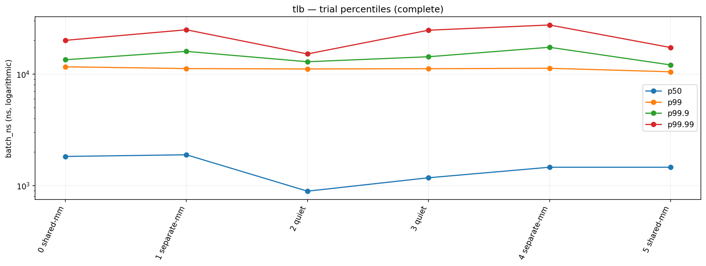
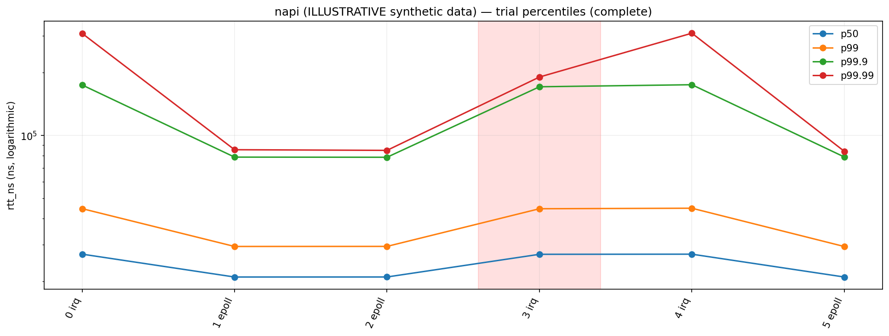
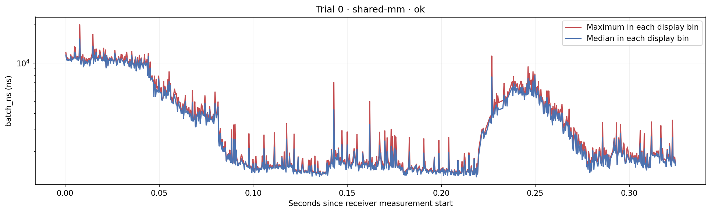
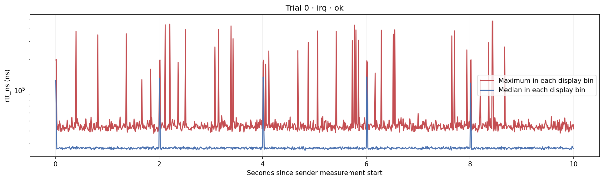
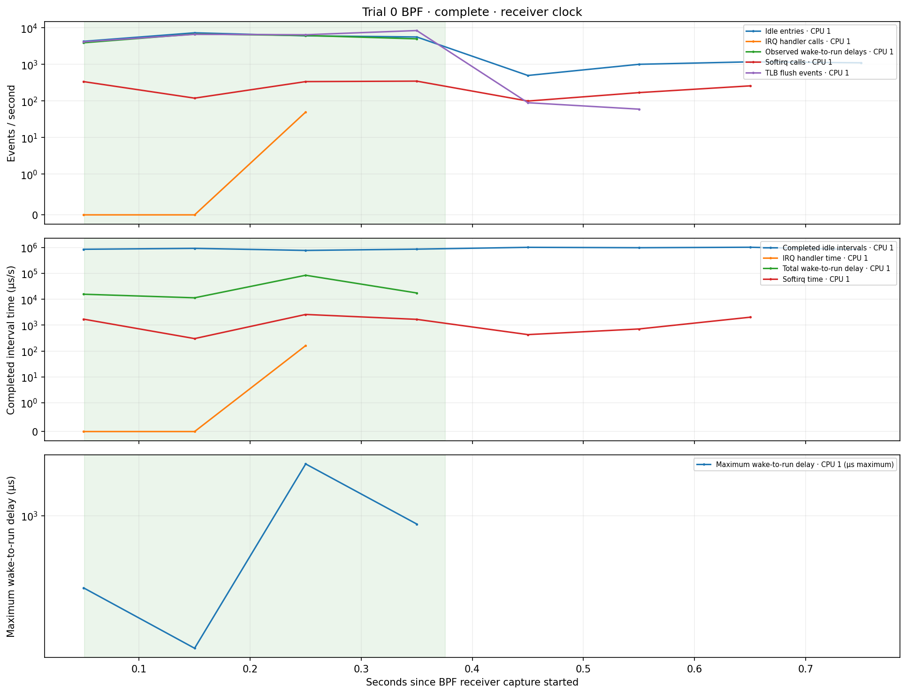
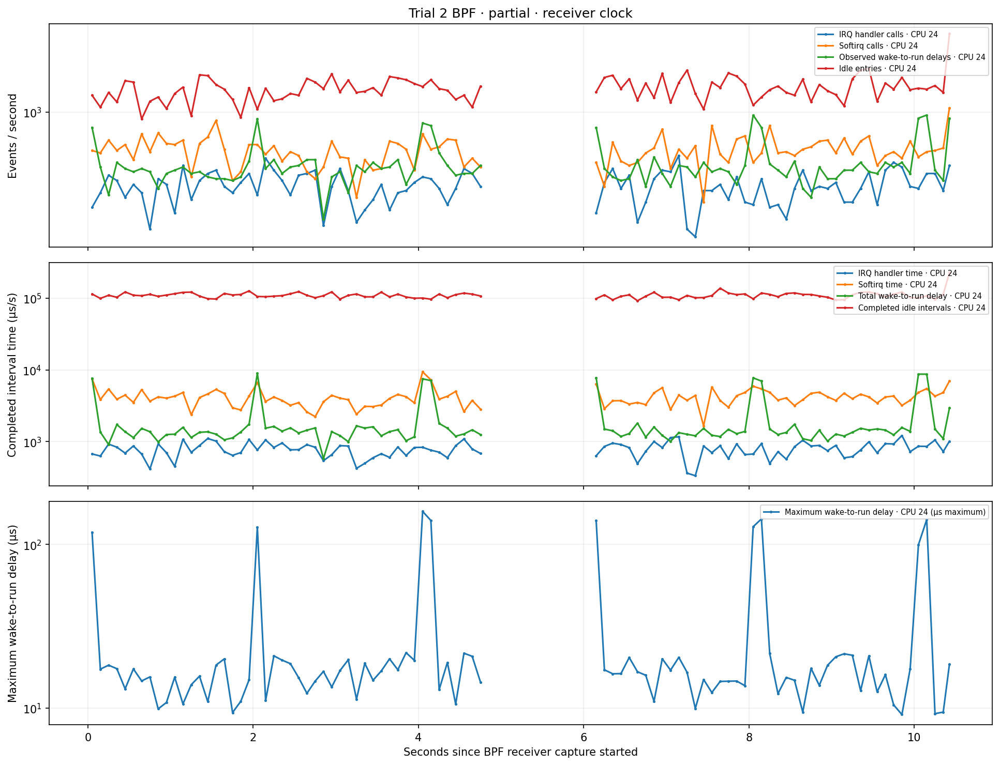
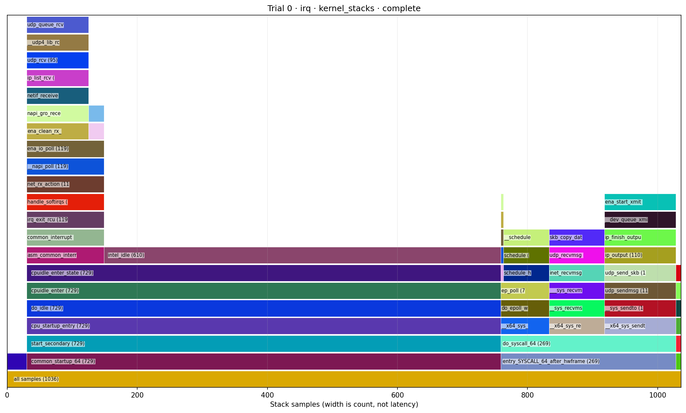
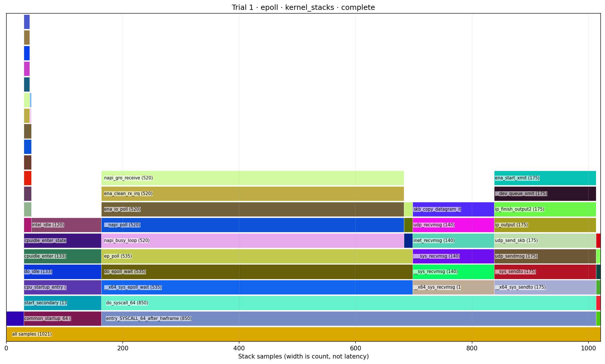
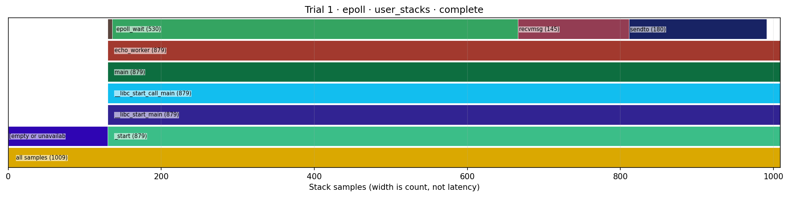

# Graph examples

`python3 -m metalbench graph <run>`, or `--graphs` on a run, writes a `graphs/`
folder with one overview per run plus figures for each trial. This page shows one
example of each graph type. Every figure was drawn by `metalbench/graphs.py`
without changes.

Each figure is labelled with its source:

* **Measured:** the `tlb` smoke run in [`results/bpf-events-smoke`](../../results/bpf-events-smoke/report.md).
  It has 6 trials of 2,000 batches with BPF event tracing, on local Linux 6.17
  using a CPU that isn't isolated. It validates the harness and says nothing
  about tuning on AWS metal.
* **Illustrative:** a synthetic `napi` run from
  [`make_synthetic_napi.py`](make_synthetic_napi.py). It covers what the smoke run
  didn't produce: UDP round-trip time (RTT), an invalid trial, a partial capture
  and flame graphs. The numbers are made up. Don't read results from them.

| Graph | File | Produced |
|---|---|---|
| [Percentile overview](#percentile-overview) | `overview.svg` / `.png` | Always, one per run |
| [Latency timeline](#latency-timeline) | `trial-NNN-latency.svg` / `.png` | Every trial with raw samples |
| [BPF event timeline](#bpf-event-timeline) | `trial-NNN-bpf.svg` / `.png` | `--bpf`, when events were captured |
| [Kernel flame graph](#kernel-flame-graph) | `trial-NNN-kernel_stacks.svg` / `.png` / `.folded` | `--bpf-stacks` |
| [User flame graph](#user-flame-graph) | `trial-NNN-user_stacks.svg` / `.png` / `.folded` | `--bpf-stacks` |

The folder also contains `index.html`, an offline gallery listing every capture
warning, and `manifest.json` with plot descriptions and warnings.

## What each benchmark puts on the axes

| Benchmark | Y axis (primary metric, ns) | Overview variants | Timeline clock | Green span on BPF graph |
|---|---|---|---|---|
| `tlb` | `batch_ns` | shared-mm, separate-mm, quiet | Receiver | Yes |
| `elc` | `wakeup_plus_batch_ns` (`batch_ns` without `--gap-us`) | current, candidate | Receiver | Yes |
| `io-cache` | `batch_ns` | current, candidate | Receiver | Yes |
| `idle` | `wakeup_plus_batch_ns` | current, candidate | Receiver | Yes |
| `napi` | `rtt_ns` | irq, software, epoll by default; threaded optional (`--modes`) | Sender | No |
| `rcu` | `operation_ns` | wake or poll, one run per boot | Receiver | Yes |
| `network` | `rtt_ns` | current | Sender | No |

Each `rcu` boot is a separate run with its own graphs. `compare-rcu` writes a JSON
comparison, not a graph.

## Percentile overview

* Each trial gets one point for p50, p99, p99.9 and p99.99 of the primary metric,
  on a log scale in nanoseconds.
* The X axis lists trials in run order as "index variant". Rounds interleave the
  variants, so look for a steady gap between variants rather than a left-to-right
  trend.
* A red band marks a trial whose status isn't `ok`. Its points are still drawn,
  so leave them out when comparing.
* The graph doesn't flag underpowered tails. `report.md` asterisks any percentile
  with fewer than 20 observations beyond it.

**Measured:** `tlb`, 6 trials of 2,000 batches. Here p99.9 and p99.99 rest on
fewer than 20 tail observations, so those two lines are exploratory.



**Illustrative:** `napi` comparing irq and epoll modes. Trial 3 failed validation
and sits under a red band.



## Latency timeline

* One trial's raw samples in time order, reduced to at most 1,000 display bins.
  The full arrays stay in the trial folder.
* Red is the maximum in each bin, so a single spike can't vanish in downsampling.
  Blue is the median in each bin.
* Memory and RCU benchmarks use the receiver's clock. UDP benchmarks (`napi`,
  `network`) use the sender's clock, and the axis label says which.
* Older results without sample timestamps put the sample index on the X axis.

**Measured:** `tlb` trial 0, shared-mm: batch latency over 0.32 s on the
receiver's clock.



**Illustrative:** `napi` trial 0, irq mode: UDP RTT over 10 s on the sender's
clock. The median jumps every 2 s, which points to a periodic burst. Lone red
spikes are single slow packets.



## BPF event timeline

* Three stacked panels on the receiver's clock: event rate (events/s), completed
  interval time (µs per second), and the longest wake-to-run delay in each
  bucket (µs).
* Each event series gets one line per traced CPU. Buckets are 100 ms by default
  (`--bpf-bin-ms`).
* Green shading marks the timed part of a memory or RCU test. UDP RTT runs on the
  sender's clock, so `napi` and `network` graphs have no green span.
* A gap means the capture lost data and its status is `partial`. A complete
  capture draws empty buckets as zero.
* Interval times can overlap, for example an IRQ inside a softirq inside an idle
  period. Don't add the lines together as CPU percentages.

**Measured:** `tlb` trial 0, CPU 1, tracing the sched, tlb, irq, softirq and idle
groups. TLB flushes and wakeups drop sharply once the green measurement window
ends.



**Illustrative:** `napi` trial 2, CPU 24, a partial capture. The break from about
4.8 s to 6.1 s is missing data, not a quiet period.



## Kernel flame graph

* Kernel stacks sampled at 99 Hz by default (`--bpf-hz`), from every task on the
  traced CPUs for the whole capture, including background services and capture
  startup and shutdown.
* The root is at the bottom. A frame's width is its sample count, not latency or
  time spent blocked.
* Colors come from a hash of the function name, so a function keeps its color
  across trials and runs. That helps side-by-side variant comparisons.
* Frames under 3.5% of samples get no label. The `.folded` file keeps every frame
  for other flame-graph tools.

**Illustrative:** irq mode. Most samples are idle (`intel_idle`). Receive work
arrives through interrupt, softirq and `ena_io_poll`.



**Illustrative:** epoll mode. The same receive path runs inside `epoll_wait` →
`napi_busy_loop`, and idle shrinks to a sliver.



## User flame graph

* The same samples as the kernel graph, user-space stacks only. Names need frame
  pointers and symbols, which the default native build provides.
* Samples with no user stack, such as the idle task and kernel threads, are
  grouped under `[empty or unavailable stack]`. Unresolved addresses stay as hex;
  the renderer never guesses a name.

**Illustrative:** epoll mode. `echo_worker` spends most of its samples in
`epoll_wait`, which is where busy polling happens.



## Regenerate the illustrative set

```sh
python3 docs/graph-examples/make_synthetic_napi.py /tmp/napi-example
```

The output directory must not exist yet. The script seeds its random generator,
so the data is the same on every run. It needs `matplotlib`.
